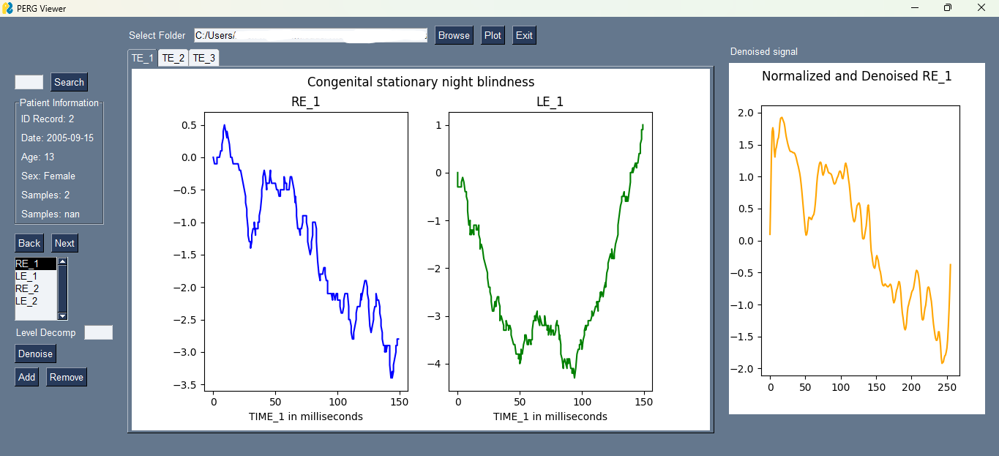

# PERG Viewer

A desktop application for analyzing and denoising Pattern Electroretinogram (PERG) signals from the [PERG-IOBA Database](https://data.mendeley.com/datasets/2gfxzb4vr2/2), a clinical repository of electroretinograms used in ocular electrophysiology research.



## Overview

PERG Viewer provides researchers and ophthalmologists with a GUI to visualize, denoise, and extract features from PERG recordings. The application processes multi-channel binocular signals across multiple test episodes, applies wavelet-based denoising, and exports compressed coefficient representations for downstream machine learning classification.

### Key Features

- **Signal Visualization** — Multi-episode (up to 3) binocular PERG signal plotting with time-axis formatting and dual-eye comparison (right eye / left eye)
- **Wavelet Denoising** — Daubechies-4 (db4) wavelet decomposition with configurable decomposition levels for noise filtering
- **Patient Database** — Navigation and search across 337 patient records with metadata (age, sex, diagnosis, visual acuity)
- **Feature Extraction** — Flattened wavelet coefficient export to CSV for machine learning pipelines

## Data Pipeline

```
Raw PERG CSV files (time-series per eye/episode)
        ↓
    Min-Max Normalization → [-2, 2] range
        ↓
    Daubechies-4 Wavelet Decomposition (N levels)
        ↓
    Detail Coefficient Zeroing → Noise Filtering
        ↓
    Inverse Wavelet Reconstruction → Denoised Signal
        ↓
    Coefficient Flattening → Feature Vector Export (CSV)
```

## Signal Processing

The denoising pipeline uses the **Daubechies-4 wavelet** with periodic boundary handling:

1. **Normalize** — Min-max scaling maps raw signal amplitudes to a [-2, 2] range
2. **Decompose** — Multi-level wavelet decomposition separates approximation and detail coefficients
3. **Filter** — Detail coefficients are zeroed out at specified levels to remove high-frequency noise
4. **Reconstruct** — Inverse wavelet transform produces the denoised signal
5. **Extract** — All non-null coefficients are flattened into a 1D feature vector for storage

The wavelet coefficient vectors serve as compressed signal representations, reducing dimensionality from thousands of raw samples to hundreds of coefficients while preserving diagnostically relevant features.

## Tech Stack

| Component | Technology |
|-----------|-----------|
| Language | Python 3 |
| GUI | PySimpleGUI (Tkinter backend) |
| Signal Processing | PyWavelets (pywt) |
| Data Processing | Pandas, NumPy |
| Visualization | Matplotlib, Seaborn |

## Project Structure

```
PERGViewer/
├── main.py                  # Application entry point & event loop (200 lines)
├── gui.py                   # Visualization, I/O, and signal processing utilities (110 lines)
├── temp.py                  # Development script for formula validation
├── participants_info.csv    # Patient metadata (337 records)
├── data.csv                 # Extracted wavelet coefficients
└── PERG_Viewer_interface.png
```

## Usage

```bash
pip install PySimpleGUI pandas numpy matplotlib pywt seaborn

python main.py
```

1. Select the folder containing PERG CSV files from the PERG-IOBA database
2. Navigate patients using Search, Next, or Back controls
3. Select an eye channel and set the decomposition level
4. Click **Denoise** to apply wavelet denoising and visualize the result
5. Click **Add** to export the coefficient feature vector to `data.csv`

## Data Source

This application is designed for the **PERG-IOBA Database**, which contains pattern electroretinogram recordings from 337 patients with conditions including normal vision, retinitis pigmentosa, macular dystrophy, and other ophthalmological diagnoses.
